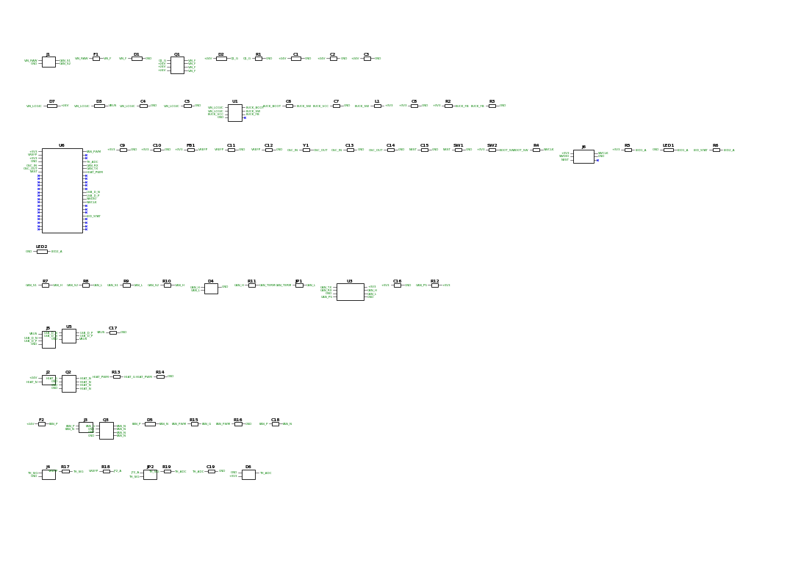

# 24V CAN Heater/Fan Controller PCB – Design Spec

Oct 23, 2026

## Overview and assumptions

A roughly 42 × 24 mm, 2-layer board with M3 mounting holes on the left and right sides that takes 24 V and CAN on one connector and drives one heater, one fan and one temperature sensor, with a 4-pin USB header for flashing and debugging. It is built around an STM32G0B1 so it runs Klipper (with Katapult bootloader) out of the box, like common 3D-printer toolhead boards.

Design targets, chosen where the request left them open:

| Parameter | Target | Why |
| --- | --- | --- |
| Supply | 24 V nominal, 12–30 V operating | Standard printer/CNC rail; 12 V works with a lower-power heater |
| Heater output | 24 V, 3 A continuous (72 W), low-side PWM | Sized for a 60–72 W cartridge (2.5–3 A) |
| Fan output | 24 V, up to 0.5 A, low-side PWM, flyback-protected | Covers 2-wire 30–50 mm fans and small blowers |
| Sensor input | 100k NTC thermistor (e.g. 3950), 4.7 kΩ pull-up | Most common hotend sensor; PT1000 option by jumper |
| CAN | Classic CAN, 500 kbit/s or 1 Mbit/s, switchable 120 Ω termination | Klipper default rates |
| USB | USB 2.0 Full Speed on a 4-pin JST-SH header, device mode; powers all logic on its own for programming, no 24 V needed | Flashing (DFU), USB-serial debug, or USB-only operation |
| Board fuse | 6.3 A on the 24 V input | Protects the harness if the heater FET fails short |

The heater output is safe-by-default: the FET gate is held off by pull-downs during reset, boot and firmware crashes.

## System architecture



The 24 V rail goes straight to the heater and fan through the protection stage; logic runs from a single 3.3 V buck that USB VBUS can also feed for bench flashing, and the MCU drives the heater and fan FETs directly.

## Power input and regulation

24 V enters through a fuse, a TVS and a reverse-polarity P-FET to become the load rail for the heater and fan. One buck makes 3.3 V for all logic; there is no 5 V rail and no separate gate-drive supply.

1. **Fuse (F1):** 6.3 A SMD fast-blow (Littelfuse Nano² 154 series or equivalent). A 72 W heater plus fan draws about 3.6 A, which would run a 5 A fuse near its derating limit in a warm toolhead. Even after a fast-blow fuse's typical 10–20% derating at 70 °C, 6.3 A stays well above the 3.6 A load.
2. **TVS (D1):** SMBJ33CA (bidirectional) from +24V to GND at the input. Clamps hot-plug and supply spikes below the 60 V rating of Q1, the output FETs and the buck. Because it's bidirectional it stays off with a reversed supply, so Q1 handles reverse polarity without blowing the fuse. Its 33 V standoff keeps it quiet with the supply set anywhere from 24 to 30 V.
3. **Reverse polarity (Q1):** P-channel MOSFET, ≥60 V / ≥8 A, low R_DS(on) (e.g. SQJ461EP or similar), source to load, drain to input. Gate to GND through 10 kΩ, with a 12 V Zener (D2) gate–source to protect V_GS.
4. **Bulk capacitance:** 1 × 47 µF / 50 V aluminium electrolytic, 105 °C long-life (≥5000 h) (not polymer: its higher internal resistance damps hot-plug ringing) plus 2 × 10 µF / 50 V X5R ceramic (JLCPCB basic; about 3 µF each at 24 V after DC-bias derating) on the 24 V rail, close to the heater and fan FETs.
5. **Logic input OR (D7, D3):** +24V → D7 → VIN_LOGIC, and USB VBUS → D3 → VIN_LOGIC, both SS210 (100 V, 2 A Schottky, a JLCPCB basic part). The board can be programmed from USB alone, and the diodes stop 24 V reaching the USB host and VBUS reaching the heater rail.
6. **24 V → 3.3 V buck (U1):** a 60 V-rated synchronous buck such as TI LMR36006 (4.2–60 V in, 600 mA), so it survives anything the TVS lets through. Inductor and output capacitor per its datasheet (about 10 µH and 22 µF). Feedback divider uses a 10 kΩ bottom resistor with the top resistor chosen from the datasheet for 3.3 V. Its 4.2 V minimum input still lets it run from VBUS through D3 (about 4.6 V). Check the package and minimum input on the exact part chosen. Total 3.3 V load is under 100 mA.
7. **Analog supply:** in the STM32G0B1CBT6's LQFP-48 package, VDDA is bonded to VDD on one pin (pin 6, VDD/VDDA) and VSSA to VSS (pin 7), but the ADC reference VREF+ is its own pin (pin 5). Feed VREF+ and the thermistor pull-up together from 3.3 V through FB1 (600 Ω @ 100 MHz), with 1 µF + 100 nF from VREF+ to pin 7, so the reading stays ratiometric. Leave the internal VREFBUF disabled (its default), since VREF+ is driven externally.

LEDs: green on 3.3 V (power good) and blue status on PB5, each with a 1 kΩ resistor. There's no heater-on LED; Klipper reports the heater state.

## CAN bus interface

A 3.3 V CAN transceiver with ±65 V bus fault protection connects the MCU's FDCAN2 peripheral to the bus.

- **Transceiver (U3):** Analog Devices MAX33012E-class (SO-8 or TDFN-8), 3.3 V supply with 100 nF. Its ±65 V fault protection on CAN_H/CAN_L means a 24 V short from the neighbouring XT30 power pins doesn't destroy it. Standby pin tied straight to GND for normal mode. Check the supply range and pinout on the exact part. Avoid the SN65HVD230 and TCAN330, whose bus pins only tolerate about ±12–16 V.
- **MCU pins:** TXD → PB1 (FDCAN2_TX), RXD → PB0 (FDCAN2_RX). This matches the Klipper/Katapult option "CAN bus (on PB0/PB1)".
- **Termination (R_T, JP1):** 120 Ω, 0805, in series with a solder jumper across CAN_H/CAN_L. Bridge it only on the board at the end of the bus.
- **ESD (D4):** NUP2105L or PESD2CAN (SOT-23) on CAN_H/CAN_L to GND, placed at the connector.
- **Optional common-mode choke (L2):** 51 µH CAN choke (e.g. ACT45B-510-2P) with 0 Ω bypass footprints. Leave it bypassed unless EMC testing calls for it.
- **Routing:** CAN_H/CAN_L as a tightly coupled pair, 120 Ω differential where practical, no stubs longer than ~10 mm between connector, ESD, termination and transceiver.

Crystal: an 8 MHz HSE crystal (±20 ppm or better) on PF0/PF1 is required for reliable 1 Mbit/s CAN timing; the internal oscillator is not accurate enough.

## Microcontroller and pin assignment

The MCU is an STM32G0B1CB in the 105 °C temperature grade (order code ending T7, or T3 for 125 °C, if stocked; the common CBT6 is only rated to 85 °C ambient): a Cortex-M0+ at 64 MHz with 128 KB flash in LQFP-48, chosen because it has both FD-CAN and crystal-less USB and is fully supported by Klipper and Katapult.

| Function | MCU pin | Peripheral | Notes |
| --- | --- | --- | --- |
| CAN RX | PB0 | FDCAN2_RX | To transceiver RXD |
| CAN TX | PB1 | FDCAN2_TX | To transceiver TXD |
| USB D− | PA11 | USB_DM | Via USBLC6 to J5 |
| USB D+ | PA12 | USB_DP | Via USBLC6 to J5 |
| Heater PWM | PB13 | GPIO / TIM1_CH1N | To Q2 gate via 10 kΩ; 10 kΩ pull-down at the pin |
| Fan PWM | PA0 | TIM2_CH1 | To Q3 gate via 1 kΩ; 10 kΩ pull-down at the pin |
| Thermistor | PA3 | ADC1_IN3 | RC-filtered, clamped |
| Status LED | PB5 | GPIO | Blue LED, 1 kΩ to GND |
| SWDIO | PA13 | SWD | To debug pads |
| SWCLK / BOOT0 | PA14 | SWD / BOOT0 | BOOT button (SW2) to 3.3 V through 1 kΩ |
| HSE | PF0 / PF1 | OSC_IN / OSC_OUT | 8 MHz, 20 pF-load crystal with 2 × 33 pF C0G load caps (adjust for board stray capacitance; check oscillator gain margin per ST AN2867) |
| Reset | NRST | — | 100 nF to GND, RESET button (SW1) to GND |

Decoupling: 100 nF on the single VDD/VDDA pin plus one 10 µF bulk on the 3.3 V rail near the MCU. Unused pins are left as test pads where space allows (PA1, PA2, PB3, PB4 are useful for a future endstop or fan tach).

## Heater control output

The heater is switched low-side by a 60 V N-MOSFET driven straight from an MCU pin. The FET is chosen to be fully on at the MCU's 3.3 V, so no gate driver is needed.

- **Heater FET (Q2):** 60 V N-MOSFET with R_DS(on) ≤ 30 mΩ specified at V_GS = 2.5 V (50 mΩ absolute maximum), ideally rated for 175 °C junction, in a 3 × 3 mm DFN or PowerPAK 1212-8 package. Pick it from a distributor's parametric search with those filters; the choice is narrower than at 40 V, and the 2.5 V rating is the one that matters. On-resistance rises about 50% as the FET heats up inside a warm printer, so at 3 A a 30 mΩ part dissipates about 0.4 W and a 50 mΩ part about 0.7 W. See Thermal for what that means and the copper it needs.
- **Gate network:** 10 kΩ series resistor from PB13 to the gate, and a 10 kΩ pull-down from PB13 to GND on the MCU side of it. The pull-down holds the heater off while the MCU is in reset or unprogrammed; putting it on the MCU side means the gate still sees the full 3.3 V rather than a divided voltage. The 10 kΩ series resistor also limits the current into PB13 to a safe level if the FET ever fails with its gate shorted to 24 V. Switching takes about 10–20 µs, which is negligible at heater PWM rates.
- **Output:** heater connects between +24V (fused) and the FET drain.
- **Firmware safety:** Klipper's `max_power`, `verify_heater` and thermal-runaway checks are the primary protection. For an unattended machine, add a thermal fuse in the heater block itself.

PWM frequency: Klipper defaults to slow software PWM (~10 Hz) for heaters, which keeps switching losses negligible.

## Fan control output

The fan uses the same direct-drive low-side topology as the heater, with a flyback diode because a fan motor is inductive.

- **Fan FET (Q3):** same part as Q2, for a single BOM line.
- **Gate network:** 1 kΩ series resistor from PA0, with a 10 kΩ pull-down from PA0 to GND on the MCU side. The fan keeps the smaller series resistor because it switches at up to 1 kHz.
- **Flyback diode (D5):** SS210 (2 A, 100 V Schottky, SMA) across the fan terminals, cathode to +24V.
- **Snubber cap (C):** optional 100 nF / 50 V across the output footprint, unpopulated by default.
- **PWM:** hardware PWM on PA0 (TIM2_CH1). Use a low frequency (about 100 Hz–1 kHz) for 2-wire fans to avoid whine and stalling. 25 kHz only applies to 4-wire fans with their own PWM input, and it would also cause noticeable switching loss with the 1 kΩ gate resistor.

The fan connector is a 2-pin JST-SH rated 1 A, so keep the fan at 0.5 A or less. A resettable PTC fuse (F2: 0.75 A hold at 25 °C, rated ≥30 V, 1812; a PTC's hold current drops to roughly two-thirds at 70 °C, so this size still carries a 0.5 A fan in a hot chamber without nuisance trips) in the fan's +24V line protects the connector and traces if the fan cable shorts, since the 6.3 A main fuse would never blow in time. If you later want tach feedback, PA1 is free and can be broken out to a third pin with a 10 kΩ pull-up to 3.3 V.

## Sensor input

The sensor input is a ratiometric thermistor divider on ADC pin PA3, filtered and clamped so a heater-to-sensor short cannot destroy the MCU.

- **Pull-up:** 4.7 kΩ 0.1% (25 ppm/°C) from the ADC reference rail (see Power, analog supply) to the sensor pin. This is Klipper's default `pullup_resistor` for 100k NTCs.
- **PT1000 option (JP2):** a 2-pin 2.54 mm jumper header puts a 4.12 kΩ 0.1% resistor in parallel with the 4.7 kΩ: no shunt = 4.7 kΩ (100k NTC), shunt fitted ≈ 2.2 kΩ (PT1000). Place the header right beside the pull-up resistors so the extra trace stays short and away from the heater and fan. Set `pullup_resistor` in firmware to match.
- **Filter:** 1 kΩ series resistor into PA3, then 100 nF X7R to AGND at the pin. Time constant ≈ 0.1 ms, far faster than thermal changes, and it gives the ADC a low-impedance source.
- **Protection:** BAT54S dual Schottky on PA3 (to 3.3 V and to GND) after the 1 kΩ, so a 24 V fault is limited to about 22 mA into the clamp.
- **Ground:** the sensor return goes to AGND, joined to GND at a single point near the MCU's VSS/VSSA pin (pin 7; VSSA is bonded to VSS in this package).

Only one sensor-type assumption matters here: if you plan to use a thermocouple or a PT100, this circuit is not suitable and needs a dedicated front end (MAX31856 or MAX31865 over SPI).

## USB debug header

Debugging uses a 4-pin JST-SH USB header (USB 2.0 Full Speed) for flashing and serial logs, plus a Tag-Connect footprint for SWD. Neither needs a component taller than 3 mm.

- **USB header (J5):** JST-SH 1.0 mm, 4-pin, side-entry (SM04B-SRSS-TB): pin 1 VBUS, 2 D−, 3 D+, 4 GND. Use a JST-SH-to-USB-A cable on the bench.
- **ESD (U5):** USBLC6-2SC6 on D+/D−/VBUS, right at the header.
- **Data lines:** D+ → PA12, D− → PA11, routed as a 90 Ω differential pair and kept short.
- **VBUS:** to VIN_LOGIC through D3 (see Power), plus 10 µF. No CC resistors are needed without a USB-C receptacle.
- **SWD (J6):** Tag-Connect TC2030-NL footprint (no part fitted) carrying 3.3V, SWDIO (PA13), SWCLK (PA14), NRST and GND for an ST-Link or J-Link.
- **BOOT and RESET:** two side-push right-angle tactile switches (SW1 RESET, SW2 BOOT, about 3.5 × 3 mm each) on the right edge next to J5, reachable with the board mounted. Hold BOOT and tap RESET to enter the ROM DFU bootloader. On the STM32G0 the BOOT0 pin is only read when the nBOOT_SEL option bit is cleared, so set nBOOT_SEL = 0 over SWD during first programming. A blank chip enters DFU regardless.

What USB gives you: DFU flashing, Katapult flashing, Klipper's USB-serial mode for bench testing without a CAN adapter, and USB-to-CAN bridge mode if this board should ever be the CAN master. Bench note: with USB connected to a PC and 24 V connected at the same time, the PC and printer grounds are tied through the USB cable. If CAN errors appear while debugging, use a laptop on battery or an isolated USB adapter.

## Connectors and pinouts

Power and CAN come in on one Amass XT30(2+2) hybrid connector: two heavy power contacts for 24 V and GND plus two small signal contacts for CAN_H and CAN_L. The heater keeps a Nano-Fit for current, and every low-current connection uses 1.0 mm JST-SH.

| Ref | Function | Connector | Pin 1 | Pin 2 | Pin 3 | Pin 4 |
| --- | --- | --- | --- | --- | --- | --- |
| J1 | 24 V + CAN in | Amass XT30PW(2+2)-M, right-angle (power pins ≈15 A, signal pins for CAN) | +24V (power) | GND (power) | CAN_H (signal) | CAN_L (signal) |
| J2 | Heater | Molex Nano-Fit 2.5 mm, 1×2, right-angle | +24V (fused) | HEATER− (FET drain) | — | — |
| J3 | Fan | JST-SH 1.0 mm, 2-pin, side-entry (1 A rated) | +24V via F2 (PTC) | FAN− (FET drain) | — | — |
| J4 | Thermistor | JST-SH 1.0 mm, 2-pin, top-entry | TH_SIG | AGND | — | — |
| J5 | USB debug | JST-SH 1.0 mm, 4-pin, side-entry | VBUS | D− | D+ | GND |
| J6 | SWD | Tag-Connect TC2030-NL footprint | 3.3V | SWDIO | SWCLK | NRST, GND |
| JP1 | CAN termination | Solder jumper (2-pad) | — | — | — | — |
| JP2 | PT1000 pull-up | 2-pin 2.54 mm header + shunt | — | — | — | — |

The XT30 housing keys the power polarity, but which small pin carries CAN_H and which carries CAN_L varies between BTT and Voron-style boards and even between revisions, so there's no single cable to copy. Instead, the two signal pins pass through a CAN swap block of four 0603 0 Ω footprints: fit the straight pair by default (S1 = CAN_H, S2 = CAN_L), or the crossed pair if your cable is wired the other way. A reversed pair doesn't damage anything; the board just won't appear on the bus until it's swapped. Check your cable against the controller-end silkscreen before the first power-up. With the fan on JST-SH, keep the fan at 0.5 A or less for margin under the connector's 1 A rating. J3 and J4 use different entry directions so the two 2-pin SH plugs are hard to swap. JST-SH housings are typically rated to about +85 °C including contact heating, so mount the board where the chamber air stays below that, away from the heater block's radiant heat.

## Bill of materials

About 60 placements and 7 resistor values. Part numbers are suggestions: check stock, footprints and current datasheets before ordering. The machine-readable BOM is `hardware/bom_jlcpcb.csv`.

| Ref | Part | Package | Qty | Notes |
| --- | --- | --- | --- | --- |
| U1 | 60 V synchronous buck, set to 3.3 V (e.g. LMR36006) | Per part | 1 | 4.2–60 V in; inductor and caps per datasheet |
| U3 | 3.3 V CAN transceiver, ±65 V fault-protected (e.g. MAX33012E) | SO-8 / TDFN-8 | 1 | Verify supply range and pinout |
| U5 | USBLC6-2SC6 USB ESD | SOT-23-6 | 1 | |
| U6 | STM32G0B1CBT7 MCU (105 °C grade; CBT6 is 85 °C) | LQFP-48 | 1 | |
| Q1 | 60 V P-MOSFET, ≥8 A (e.g. SQJ461EP) | PowerPAK SO-8 | 1 | Reverse polarity |
| Q2, Q3 | 60 V N-MOSFET, ≤30 mΩ at V_GS = 2.5 V (50 mΩ max) | 3 × 3 mm DFN | 2 | Heater, fan; driven directly by the MCU |
| Y1 | 8 MHz crystal, ±20 ppm, 20 pF load, −40 to +85 °C (YXC X50328MSB2GI) | 5032 | 1 | JLCPCB basic C115962; 2 × 33 pF C0G load caps (C1663) |
| F1 | 6.3 A fast-blow fuse | Nano² / 1206 | 1 | Main 24 V input |
| F2 | PTC resettable fuse, 0.75 A hold, ≥30 V | 1812 | 1 | Fan +24V |
| D1 | SMBJ33CA bidirectional TVS | SMB | 1 | Stays off with a reversed supply |
| D2 | 12 V Zener | SOD-123 | 1 | Q1 gate clamp |
| D3, D5, D7 | SS210 Schottky, 100 V 2 A | SMA | 3 | USB OR, fan flyback, 24 V OR |
| D4 | NUP2105L CAN ESD | SOT-23 | 1 | |
| D6 | BAT54S dual Schottky | SOT-23 | 1 | Sensor clamp |
| LED1, LED2 | Green (3V3 power), blue (status) | 0603 | 2 | |
| FB1 | Ferrite bead 600 Ω @ 100 MHz | 0603 | 1 | Feeds VREF+ (pin 5) and the thermistor pull-up |
| SW1, SW2 | Side-push right-angle tactile switch | ≈3.5 × 3 mm SMD | 2 | RESET, BOOT |
| R | 0 Ω | 0603 | 2 | CAN swap (2 of 4 footprints fitted) |
| R | 120 Ω | 0805 | 1 | CAN termination |
| R | 1 kΩ | 0603 | 5 | Fan gate series, sensor filter, BOOT, LEDs ×2 |
| R | 4.12 kΩ 0.1% 25 ppm | 0603 | 1 | PT1000 option, switched by JP2 |
| R | 4.7 kΩ 0.1% 25 ppm | 0603 | 1 | Thermistor pull-up |
| R | 10 kΩ | 0603 | 5 | Heater gate series, pin pull-downs ×2, Q1 gate, buck FB bottom |
| R | Buck FB top, 1% | 0603 | 1 | Value per buck datasheet for 3.3 V |
| C | 47 µF 50 V aluminium electrolytic, 105 °C, ≥5000 h | 6.3 mm SMD | 1 | 24 V bulk; not polymer |
| C | 10 µF 50 V X5R (JLCPCB basic C13585) | 1206 | 2 | 24 V ceramic |
| C | 22 µF 25 V X5R 1206, 10 µF 25 V X5R 0805, 1 µF 50 V X5R, 100 nF 50 V X7R, 33 pF C0G | 0402–0805 | ~13 | All JLCPCB basic: C12891, C15850, C15849, C14663, C1663 |
| J1 | Amass XT30PW(2+2)-M.G.B | Through-hole, right-angle | 1 | 24 V + CAN; LCSC C19268030; footprint from SnapEDA in the project library |
| J2 | Molex Nano-Fit 1×2 right-angle | SMD/TH per series | 1 | Heater |
| J3, J4 | JST-SH 2-pin (one side-entry, one top-entry) | 1.0 mm | 2 | Fan, thermistor |
| J5 | JST-SH 4-pin side-entry | 1.0 mm | 1 | USB; J6 is a footprint only |
| JP2 | 2-pin 2.54 mm header + shunt | Through-hole | 1 | NTC / PT1000 select |

**JLCPCB sourcing.** JLCPCB charges a feeder fee for every "extended" part type, so the design uses JLCPCB basic parts wherever one meets the spec. LCSC numbers were checked against JLCPCB's basic/preferred parts list in October 2026; confirm stock when ordering.

| Function | JLCPCB basic part | LCSC # |
| --- | --- | --- |
| 100 nF decoupling | Yageo CC0603KRX7R9BB104, 50 V X7R 0603 | C14663 |
| FB1 ferrite bead | Sunlord GZ1608D601TF, 600 Ω @ 100 MHz 0603 | C1002 |
| D3, D5, D7 Schottky | MDD SS210, 100 V 2 A SMA | C14996 |
| CAN termination | Uni-Royal 120 Ω 1% 0805 | C17437 |
| 8 MHz crystal | YXC X50328MSB2GI, 5032, 20 pF load | C115962 |
| 33 pF load caps | Samsung CL10C330JB8NNNC, C0G 0603 | C1663 |
| 1–22 µF ceramics | X5R: 1 µF 50 V, 10 µF 25 V, 10 µF 50 V, 22 µF 25 V | C15849, C15850, C13585, C12891 |

These parts stay extended because no basic part meets the spec: the MCU (no basic STM32 has both FD-CAN and a USB bootloader), the 60 V buck, the ±65 V CAN transceiver, the 60 V 2.5 V-rated FETs, the reverse-polarity FET, both fuses, the TVS, the 0.1% thermistor resistors and all connectors. The crystal and X5R ceramics are rated to 85 °C, which leaves about 35 °C of margin at the expected 50 °C ambient.

## PCB layout guidance

Target a 42 × 24 mm, 2-layer, 1.6 mm board with 1 oz copper (2 oz would crowd the 0.5 mm-pitch MCU and 1.0 mm JST-SH pads); the bottom layer is a near-solid ground plane and the top carries power pours and signals.

**Floorplan (top view):**

- **Mounting holes (left and right sides):** two M3 holes, 3.2 mm plated drill with a 6 mm pad and a 6.5 mm component keep-out. The holes are isolated from GND by default, with an optional bond footprint beside each (0 Ω, or 1 MΩ ∥ 4.7 nF) so a metal mount tied to the printer frame doesn't create a ground loop through the CAN cable. They are centred on the board's horizontal centreline 3.5 mm in from each short edge, 35 mm apart centre-to-centre.
- **Left side:** J1 (XT30 2+2, about 10 mm wide) on the left edge beside the left mounting hole, then F1, D1, Q1 and the bulk caps in a straight line inward. CAN ESD and the JP1 termination pads sit right behind J1's signal pins.
- **Top edge:** J2 (heater Nano-Fit) and J3 (fan SH), with Q2, Q3 and D5 directly behind them so the high-current loop is short. Keep the gate series resistors right at the FETs and the pull-downs at the MCU pins.
- **Centre:** U6 (MCU) with Y1 under 5 mm from PF0/PF1, U3 between J1 and the MCU's PB0/PB1. U1 and its inductor go on the far side of the MCU from the thermistor input.
- **Right side:** J5 (SH USB) plus the side-push RESET (SW1) and BOOT (SW2) buttons on the right edge, beside the right mounting hole, with U5 at the USB header. The TC2030 SWD footprint can go on the bottom side, under the MCU.
- **Bottom edge:** J4 (thermistor SH), its RC filter and clamp close to PA3, away from the heater traces.

**Current and copper:**

- Heater path (J1 → F1 → Q1 → J2, and J2 → Q2 → GND): pours at least 3 mm wide on 1 oz, for 3 A at ≤ 10 °C rise. Stitch the FET source pads to the ground plane with 6+ vias (0.3 mm drill).
- Give Q2's drain pad at least 150 mm² of top copper with 9+ thermal vias to a matching bottom pour, and keep Q2 at least 5 mm from the MCU and crystal. Q3 needs about 50 mm².
- Keep the buck converter's switch node small and on the top layer, with its input cap, IC and ground return in a tight loop.

**Signal integrity:**

- CAN_H/CAN_L and USB D+/D− as coupled pairs over unbroken ground; no vias if avoidable.
- AGND: a small island under the thermistor filter and VSSA, joined to GND at one point near the MCU.
- Keep the thermistor trace at least 2 mm from heater and fan switching nodes.

**Fab:** standard JLCPCB/PCBWay rules work (0.15 mm trace/space, 0.3 mm vias). Add test points for +24V, +3V3, GND, CAN_H, CAN_L and TH_SIG.

## Thermal

The expected air temperature around the board is about 50 °C. The design is checked at a 70 °C worst case: an enclosed chamber at 60 °C plus local heat near the toolhead. Every part is rated for that, and the heater FET is the only part that runs meaningfully warm.

Estimated temperatures at full heater power (72 W, 3 A, 24 V) and 70 °C ambient:

| Part | Dissipation | Estimated temperature | Rating |
| --- | --- | --- | --- |
| Q2 heater FET, 30 mΩ part | ~0.4 W | ~100 °C junction | 150–175 °C |
| Q2 heater FET, 50 mΩ part | ~0.7 W | ~120 °C junction | 150–175 °C |
| Q1 reverse-polarity FET | ~0.4 W | ~90 °C junction | 150 °C |
| F1 fuse | ~0.15 W | ~75 °C | Derated, still above load |
| U1 buck | <0.1 W | ~75 °C | 125 °C |
| MCU, transceiver, fan FET, diodes | <0.05 W each | ~72 °C | 105 °C or higher |
| Bulk capacitor | Ripple only | ~72 °C | 105 °C long-life |

These are estimates from typical thermal resistances (about 70 °C/W for a 3 × 3 mm FET on 150 mm² of copper per side), so measure Q2's case temperature with a thermocouple during a long print on the first prototype. Temperature-sensitive choices made for this environment: the MCU's 105 °C grade (the common CBT6 is only rated to 85 °C), a 105 °C long-life electrolytic (an 85 °C part would last under a year of continuous running at 70 °C), and a fan PTC sized for its hold current at temperature. The crystal and the 1–22 µF ceramics are 85 °C-rated JLCPCB basic parts: about 35 °C of margin at the expected 50 °C, and still within rating at the 70 °C worst case.

Mounting: keep the board away from the heater block's radiant heat, ideally in the hotend fan's airflow, on standoffs so air can pass behind it. The JST-SH connectors set the practical ceiling of about 85 °C.

Supply voltage: the heater's resistance is fixed, so running at 30 V instead of 24 V raises heater current to about 3.75 A and Q2's loss by about 55%. At 30 V, set Klipper's `max_power` to 0.64 to hold heater power at 72 W.

## Bring-up and firmware

Bring the board up on USB first, then 24 V with no loads, then CAN, and connect the heater last.

1. **USB only:** check the 3.3 V rail, hold BOOT and tap RESET; the MCU should enumerate as an STM32 DFU device.
2. **Flash Katapult** (MCU STM32G0B1, 8 MHz crystal, CAN on PB0/PB1, 1 Mbit/s), then Klipper with the same settings and the Katapult bootloader offset.
3. **24 V, current-limited to ~200 mA, no loads:** confirm Q2's gate stays at 0 V through reset and boot, and that idle draw is under ~60 mA.
4. **CAN:** bridge JP1 if this is the last node, then run `~/klippy-env/bin/python ~/klipper/scripts/canbus_query.py can0` to get the UUID.
5. **Loads:** fan first, then thermistor (check room temperature reads correctly), then the heater with a PID calibration.

Example Klipper config (replace the UUID):

```
[mcu tool]
canbus_uuid: 0123456789ab

[heater_generic tool_heater]
heater_pin: tool:PB13
sensor_type: Generic 3950
sensor_pin: tool:PA3
pullup_resistor: 4700
max_power: 1.0
min_temp: 0
max_temp: 300
control: pid
pid_Kp: 22
pid_Ki: 1
pid_Kd: 100

[verify_heater tool_heater]

[fan_generic tool_fan]
pin: tool:PA0
cycle_time: 0.01

[output_pin status_led]
pin: tool:PB5
```

Run `PID_CALIBRATE HEATER=tool_heater TARGET=200` and save the results; the PID values above are placeholders. For a PT1000, fit the shunt on JP2 and change the sensor lines to `sensor_type: PT1000` and `pullup_resistor: 2200`.

**Decisions before schematic capture (all settled; two prototype checks left):**

- [x] Sensor type settled: 100k NTC or PT1000, selected by JP2
- [x] Heater power settled: 60–72 W at 24 V
- [x] J1 settled: XT30(2+2) for a BTT/Voron-style cable, CAN order set by the swap footprints
- [x] Analog supply settled: VREF+ is a separate pin (5), VDD/VDDA bonded on pin 6, so FB1 is fitted
- [x] Mounting settled: two M3 holes on the sides, 35 mm apart; fan settled at 0.5 A or less
- [ ] Prototype check (required feature): program the board from a laptop USB port with 24 V disconnected, and confirm the buck input stays above about 4.4 V (the 60 V buck needs 4.2 V minimum)
- [ ] Prototype check: measure Q2's case temperature with a thermocouple during a long print in the enclosed printer; it should stay under about 110 °C
